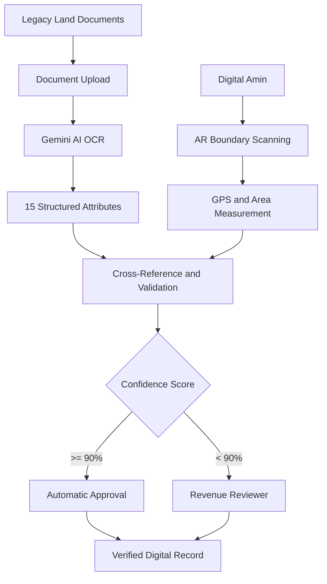

# 🌍 BhuMitra – Intelligent Land Record Digitization & Validation System

  <strong>From Paper Records to Verified Digital Land Data</strong>

  
  
  
  

## 📌 Overview

**BhuMitra** is an AI-powered land record digitization and validation system developed by Team GravityTech for Smart India Hackathon 2026.

The project aims to transform traditional paper-based land records into structured, digitally accessible and verifiable information using Generative AI, multilingual OCR, spatial scanning and augmented reality.

The system is designed to process legacy land documents, extract important parcel attributes, cross-reference recorded information with physical land boundaries, and support a confidence-based validation workflow.

### 🏆 Hackathon Achievement

- **Event:** Smart India Hackathon 2026
- **Achievement:** Internal Round Winner
- **Problem Statement ID:** SIH26018
- **Problem Statement:** Intelligent Land Record Digitization and Validation System
- **Theme:** Smart Automation
- **Category:** Software
- **Team Name:** GravityTech

---

## 🎯 Problem Statement

Traditional land record management faces several challenges:

- Large volumes of historical paper-based records.
- Difficulty processing handwritten and damaged documents.
- Language barriers across regional land records.
- Inconsistencies between documented land information and physical boundaries.
- Manual verification processes that can be time-consuming.
- Risk of missing information and property-related disputes.

BhuMitra aims to address these challenges through an integrated digital workflow combining AI-powered document processing and spatial validation.

---

## 💡 Our Solution

BhuMitra introduces an intelligent workflow that connects legacy land documents with digitally verified land information.

The proposed system combines five major components:

1. **AI-Powered Document Digitization:** Extracts structured information from traditional land records using multilingual Generative AI OCR.
2. **Digital Amin:** Enables smartphone-based boundary scanning using WebXR.
3. **Spatial Token Generation:** Combines GPS coordinates and measured land area into spatial information.
4. **Intelligent Cross-Referencing:** Compares document attributes with physical ground information.
5. **Confidence-Based Validation:** Routes records through automated approval or manual review depending on extraction confidence.

---

## ⚙️ How It Works

The BhuMitra workflow consists of five stages.

### 01. Field KYC

The surveyor initiates the land-record upload process.

### 02. AR Boundary Scanning

The Digital Amin module uses smartphone-based WebXR functionality to scan and map land plot boundaries.

### 03. Spatial Token Generation

GPS coordinates and measured land area are combined to generate spatial information, including area measurements in Gaj and Yards.

### 04. AI-Based Information Extraction

Google Gemini-powered multilingual OCR processes legacy documents and extracts 15 structured parcel attributes.

The system is designed to support nine Indic scripts.

### 05. Intelligent Validation

Extracted information is evaluated using confidence scores.

| Confidence score | Validation workflow |
|---|---|
| ≥ 90% | Automatic approval |
| < 90% | Revenue reviewer queue |

The system also incorporates missing-data flags and audit trails to support verification and accountability.

---

## 🧠 Key Features

### 1. Multilingual AI Document Processing

- Generative AI-based OCR.
- Support for nine Indic scripts.
- Processing of legacy land records.
- Extraction of 15 structured parcel attributes.
- Confidence-based extraction results.

### 2. Digital Amin – AR Spatial Scanning

- Smartphone-based land boundary scanning.
- WebXR Device API integration.
- Three.js-based spatial visualization.
- GPS-based location information.
- Land area measurement.

### 3. Intelligent Cross-Referencing

- Comparison of paper-record attributes with physical ground information.
- AR hit-testing.
- Multimodal AI-assisted verification.

### 4. Automated Validation

- Confidence score evaluation.
- Automatic approval for high-confidence records.
- Manual reviewer queue for low-confidence records.
- Missing-data detection.
- Audit trail support.

### 5. Fallback and Risk Handling

- 3D simulation fallback for devices without native WebXR support.
- Context-aware multimodal extraction for degraded legacy documents.
- Manual review and human oversight for uncertain records.

---

## 🏗️ Technical Architecture

BhuMitra uses a modern web architecture combining frontend technologies, server-side development, cloud services, spatial computing and multimodal AI.

| Layer | Technologies |
|---|---|
| Frontend | React 19, Vite, Tailwind CSS v4 |
| Backend | Node.js, Express.js |
| Authentication | Firebase Authentication |
| Database | Cloud Firestore |
| Cloud Storage | Google Cloud Storage |
| AI / ML | Google Gemini 3.8 Flash API |
| Spatial Computing | Three.js |
| Augmented Reality | WebXR Device API |
| Document Processing | Multilingual Generative AI OCR |

### Architecture Overview

---

## 📊 Expected Impact

BhuMitra aims to improve land-record management through:

| Area | Expected benefit |
|---|---|
| Processing | Reduce processing time from weeks towards minutes |
| Data extraction | 15 structured parcel attributes |
| Language support | Nine Indic scripts |
| Governance | Audit trail and improved transparency |
| Social impact | Support reduction of property disputes and encroachment detection |
| Economic impact | Support faster mutation, clearances and property transactions |

These are intended project outcomes and design targets, not independently benchmarked performance results.

---

## 🛡️ Feasibility & Risk Management

| Potential challenge | Proposed mitigation |
|---|---|
| Damaged or handwritten records | Context-aware multimodal AI extraction |
| Older smartphones without native WebXR | 3D simulation fallback |
| Low-confidence extraction | Manual revenue reviewer queue |
| Edge cases in validation | Human oversight |

The proposed deployment approach uses serverless cloud services and standard smartphone cameras without requiring specialized survey hardware.

---

## 🚀 Live Prototype

Experience the BhuMitra prototype:

**[🌐 Visit BhuMitra – Live Demo](https://bhu-mitra.ai.studio/)**

---

## 🖥️ Project Presentation

The project presentation covers:

- Problem statement and solution overview.
- Five-stage implementation workflow.
- Technical architecture.
- Feasibility and risk handling.
- Expected impact and references.

**Hackathon Problem Statement:** SIH26018

---

## 👥 Team

**Team GravityTech**

Developed as a collaborative team project for Smart India Hackathon 2026.

---

## 📚 References

- Digital India Land Records Modernization Programme (DILRMP).
- W3C WebXR Device API documentation.
- Google Gemini API documentation.

---

## 🔮 Future Scope

Potential directions for further development include:

- Expanding multilingual document-processing capabilities.
- Improving extraction accuracy for historical and handwritten records.
- Enhancing spatial validation and boundary verification.
- Integrating additional land-record databases.
- Improving accessibility across mobile devices.
- Strengthening security, auditability and human verification workflows.

---

  <strong>BhuMitra – Transforming Land Records with AI and AR</strong>
   
  Built with innovation by Team GravityTech
   
  Smart India Hackathon 2026

